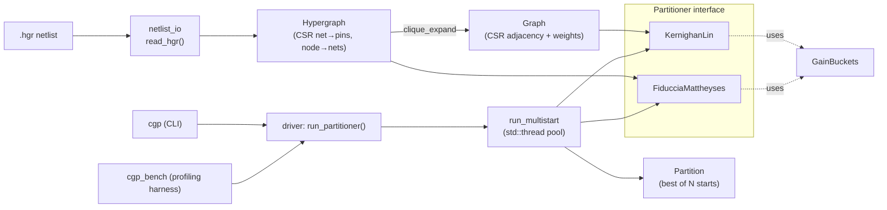

# Circuit Graph Partitioner

A C++17 command-line tool that splits circuit netlists into two balanced blocks
using the two classic iterative-improvement algorithms: **Kernighan-Lin (KL)**
on a graph model and **Fiduccia-Mattheyses (FM)** on a hypergraph model. It
reads hMETIS-style `.hgr` netlists and reports cut size, wall-clock runtime and
peak memory (RSS).

It is meant as a small, readable reference implementation for EDA engineers and
CS students. Each algorithm is a few hundred lines with no external
dependencies beyond the C++17 standard library. GoogleTest is used only for
the tests.

## Features

- **Kernighan-Lin bisection** on a weighted graph. Pair swaps keep the blocks
  exactly balanced.
- **Fiduccia-Mattheyses** on the netlist hypergraph, with **gain buckets**:
  bucket arrays of intrusive doubly linked lists, giving O(1) insert, remove
  and gain update.
- **Common `Partitioner` interface.** Both algorithms implement it, and they
  share separate `Graph`, `Hypergraph` and `Partition` classes.
- **Multithreaded multi-start.** N random initial partitions are refined in
  parallel on `std::thread` workers and the best result is kept. Results are
  deterministic for a given seed, whatever the thread count.
- **Profiling harness** (`cgp_bench`). It reports cut size, runtime and peak
  RSS for each netlist and algorithm, running each case in its own forked
  process.
- **Cache-friendly CSR / structure-of-arrays layout** for every model (see
  [Data layout](#data-layout)).
- **Two tuning optimizations.** KL uses bounded pair selection, and both
  algorithms have an optional early-exit move limit (see
  [Algorithmic tuning](#algorithmic-tuning)).
- **Netlist generator** and three benchmark netlists of 100, 5K and 50K cells.

## Algorithms

### Kernighan-Lin (graph model)

KL works on a graph. The netlist is turned into one by **clique expansion**:
each net with k ≤ 16 pins becomes a k-clique of unit edges, and parallel edges
are summed. Nets larger than the cap (`--max-net`) are skipped so the graph
stays small. Each node gets `D(v) = external(v) − internal(v)`, and swapping
`a ∈ A` with `b ∈ B` gains `D(a) + D(b) − 2·w(a,b)`.

One pass:

1. Compute `D` for every node and put each side's nodes into a gain-bucket
   structure.
2. Repeatedly pick the unlocked pair with the largest swap gain. Swap and lock
   them, then update `D` for their unlocked neighbours: `±2w` per edge.
3. Find the prefix of the swap sequence with the largest cumulative gain. Keep
   it and roll back the rest.

Passes repeat until one gives no positive gain. Because every move is a swap,
the block sizes never change.

### Fiduccia-Mattheyses (hypergraph model)

FM works directly on nets, so the cost it minimises is the true **number of
cut nets**. It moves one cell at a time. A cell's gain is the number of nets it
would uncut minus the number it would newly cut. For every net, FM keeps the
count of pins on each side. When a cell moves, only nets with 0 or 1 pins on
the "to" side (before the move) or the "from" side (after it) change any gains.
These are the standard FM critical-net rules, and they make gain updates
incremental.

Each side has its own gain-bucket array, indexed by gain in
`[−pmax, +pmax]`, where `pmax` is the largest number of nets on any cell. At
each step FM takes the highest-gain free cell from whichever side may give up
a cell without breaking balance. Each block may hold up to
`max((1+ε)·n/2, ⌊n/2⌋+1)` cells. The `+1` is the one-cell slack from the
original FM paper; without it no single move is legal from a perfectly
balanced start. ε defaults to 0.02. As in KL, each pass ends by rolling back to
the best prefix.

### Multi-start

`run_multistart` creates `--starts` random, perfectly balanced bisections and
refines them on a pool of `std::thread` workers. Workers take start indices
from an atomic counter. One `Partitioner` instance is shared by all threads:
`refine()` is `const` and all of its scratch state is local. Start `i` is
seeded from `(seed, i)`, and ties go to the lowest start index. The result is
therefore the same with 1 thread or 10. A GoogleTest case checks this.

## Architecture



```
include/cgp/             public headers
  types.hpp              NodeId / NetId / Weight
  graph.hpp              Graph (CSR) + clique_expand()
  hypergraph.hpp         Hypergraph (two CSR incidence arrays)
  partition.hpp          Partition (side per node + block sizes), balance limit
  partitioner.hpp        abstract Partitioner interface
  gain_buckets.hpp       O(1) bucket priority queue shared by KL and FM
  kernighan_lin.hpp      KL
  fiduccia_mattheyses.hpp FM
  multistart.hpp         parallel multi-start
  driver.hpp             builds the model for an algorithm and times a run
  profiling.hpp          Stopwatch, peak_rss_mb()
  netlist_io.hpp         .hgr reader/writer, partition writer
src/                     implementations + main.cpp (cgp CLI)
benchmarks/              gen_netlist.cpp (cgp_gen), bench_main.cpp (cgp_bench), *.hgr
tests/                   GoogleTest cases
```

## Data layout

All of the models are flat, contiguous `std::vector`s. No model uses per-node
heap objects or pointer-based adjacency lists.

| Structure | Layout | Why |
|---|---|---|
| `Graph` | CSR: `offsets[n+1]`, `targets[2m]`, `weights[2m]`, with weights in a separate array (SoA) | Visiting a node's neighbours is one linear scan. Loops that need only the targets, such as the KL pair search marking `w(a,·)`, don't pull the weights into cache. |
| `Hypergraph` | Two CSR arrays: `net_offsets/pins` and `node_offsets/node_nets` | FM needs both directions on every move: a cell's nets, then each net's pins. Both are sequential reads. |
| `Partition` | `std::vector<uint8_t>` side per node + two block counters | 1 byte per node, so a 50K-cell partition fits in 49 KB, and balance checks are O(1). |
| FM pin counts | One interleaved `int32` array, `pins_on[2e + side]` | A net's two counters share a cache line, and they are always read together. |
| Gain buckets | `heads[2·pmax+1]` plus per-node `next/prev/gain` arrays (an intrusive list) | O(1) updates with no allocation during a pass. Every node's links are in arrays indexed by node id. |

Both CSR structures are built with a counting sort, in O(pins) time with no
per-node vectors.

## Algorithmic tuning

### 1. Bounded pair selection in KL (always on)

Done naively, choosing the best KL swap is O(|A|·|B|) per step, and O(n³) per
pass. This implementation keeps each side's `D` values in gain buckets and
scans both sides in decreasing order of `D`. Since `w ≥ 0`, `D(a) + D(b)`
bounds the gain of any pair. The inner scan stops as soon as
`D(a) + D(b) ≤ best`, and the outer scan stops once `D(a) + max D(B)` can't
beat `best`. This is the pruning suggested in the original KL paper.

Measured on one full KL run from a random start (the pair search was counted
in an instrumented build):

| Netlist | Swaps | Pairs evaluated | Pairs / swap | Exhaustive scan would evaluate |
|---|---:|---:|---:|---:|
| small_100 | 250 | 255 | 1.02 | 2.2 × 10⁵ |
| medium_5k | 10,000 | 10,004 | 1.00 | 2.1 × 10¹⁰ |
| large_50k | 275,000 | 275,036 | 1.00 | 5.7 × 10¹³ |

In practice each step evaluates about one pair. The cost of a pass is then
dominated by the O(E) neighbour `D` updates instead of the pair search. With an
exhaustive search, KL on the 50K netlist would not finish in reasonable time.
These counts come from an instrumented build on macOS.

### 2. Early-exit move limit (`--stall-limit N`, off by default)

A pass ends early after N consecutive moves (or swaps) that fail to improve the
best prefix found so far in that pass. Most passes find their best prefix
early, so this cuts runtime sharply. FM on these netlists, however, keeps
gaining from long runs of negative-gain moves, so the early exit **costs
quality**. Measured on `large_50k` (8 starts, 8 threads; same environment as
the main results):

| Stall limit | KL net cut | KL time (s) | FM net cut | FM time (s) |
|---|---:|---:|---:|---:|
| off (full passes) | 6,885 | 0.098 | **3,543** | 0.234 |
| 5000 | 7,256 | 0.027 | 5,075 | 0.037 |
| 1000 | 7,256 | 0.023 | 5,554 | 0.020 |
| 100 | 7,387 | 0.017 | 6,056 | 0.013 |

At a limit of 100, KL runs 5.7× faster and finds a 7% worse cut. FM runs 18×
faster and finds a 71% worse cut. Full passes stay the default. The early exit
is useful when you need a fast, approximate answer.

## Build

Requirements: a C++17 compiler, CMake ≥ 3.16, and a POSIX system (Linux or
macOS). The project has been tested with GCC 13 on Linux and Apple Clang 21 on
macOS. If GoogleTest isn't installed, CMake downloads
it with `FetchContent`.

```bash
cmake -S . -B build -DCMAKE_BUILD_TYPE=Release
cmake --build build -j
ctest --test-dir build --output-on-failure     # GoogleTest cases
```

Add `-DCGP_BUILD_TESTS=OFF` to skip GoogleTest.

## Usage

Partition a single netlist:

```bash
./build/cgp benchmarks/large_50k.hgr --algo fm --starts 8 --threads 8 --out large.part
```

```
netlist     : benchmarks/large_50k.hgr (50000 nodes, 49049 nets, 154253 pins)
algorithm   : FM, 8 starts on 8 threads, stall limit 0
net cut     : 3543
start costs : min 3543, max 4573 (best = start 4)
block sizes : 24998 / 25002
runtime     : 0.231893 s
peak RSS    : 21.5234 MB
```

| Option | Default | Meaning |
|---|---|---|
| `--algo kl\|fm` | `fm` | Algorithm |
| `--starts N` | 8 | Number of random initial partitions |
| `--threads N` | hardware threads | Worker threads for the multi-start |
| `--seed N` | 1 | RNG seed |
| `--eps X` | 0.02 | FM balance tolerance |
| `--stall-limit N` | 0 (off) | Early-exit move limit |
| `--max-net N` | 16 | Largest net size included in KL's clique expansion |
| `--out FILE` | none | Write the partition, one side (0/1) per line |

Run the profiling harness over several netlists:

```bash
./build/cgp_bench benchmarks/small_100.hgr benchmarks/medium_5k.hgr benchmarks/large_50k.hgr
./build/cgp_bench --stall-limit 1000 --threads 1 benchmarks/*.hgr
```

Generate more netlists:

```bash
./build/cgp_gen --nodes 200000 --seed 4 --out benchmarks/xl_200k.hgr
```

### Netlist format

The input is the hMETIS `.hgr` format without weights. Lines starting with `%`
are comments. The first data line is `<num_nets> <num_nodes>`, and each
following line lists one net's pins as 1-based cell ids:

```
% two triangles joined by one net
7 6
1 2
2 3
1 3
4 5
5 6
4 6
3 4
```

## Benchmark netlists

The three netlists in `benchmarks/` come from `cgp_gen`. They are synthetic,
not industrial circuits. Cells sit on a √N × √N grid and each cell drives one
net. Fanout is mostly 1–3 (45% have fanout 1, 25% fanout 2, 15% fanout 3, and
15% fanout 4–8). 97% of sinks are within ±2 grid steps of the driver and 3% are
anywhere in the circuit. This gives the netlists the locality of a placed
design, so a good bisection cuts far fewer nets than a random one.

| File | Cells | Nets | Pins | Generator seed |
|---|---:|---:|---:|---:|
| `small_100.hgr` | 100 | 96 | 287 | 1 |
| `medium_5k.hgr` | 5,000 | 4,900 | 15,143 | 2 |
| `large_50k.hgr` | 50,000 | 49,049 | 154,253 | 3 |

## Benchmark Results

These numbers were measured with `cgp_bench` using the defaults: 8 starts,
seed 1, ε = 0.02 and full passes. The thread count defaults to the hardware
concurrency (10) and is capped at the number of starts, so 8 threads ran.

- **Environment:** GCC 13.5, `-O3` Release build, in a Linux container
  (`gcc:13` Docker image) on an Apple M5 host.
- **Net cut:** the number of nets with pins in both blocks. This is the common
  metric for both algorithms. KL itself minimises the clique-graph edge cut,
  which is shown separately.
- **Random net cut:** the cut of one random balanced partition, for reference.
- **Runtime:** wall-clock time to build the model (clique expansion, for KL)
  plus the multi-start refinement. It excludes reading the file.
- **Peak RSS:** the high-water mark of the forked process that ran that case,
  including the parsed netlist.

| Netlist | Cells | Algo | Random net cut | Net cut | KL edge cut | Blocks | Runtime (s) | Peak RSS (MB) |
|---|---:|---|---:|---:|---:|---|---:|---:|
| small_100 | 100 | KL | 55 | 13 | 32 | 50 / 50 | 0.0004 | 2.7 |
| small_100 | 100 | FM | 55 | **9** | – | 49 / 51 | 0.0003 | 2.7 |
| medium_5k | 5,000 | KL | 3,317 | 657 | 1,523 | 2500 / 2500 | 0.0065 | 4.6 |
| medium_5k | 5,000 | FM | 3,317 | **294** | – | 2533 / 2467 | 0.0109 | 4.2 |
| large_50k | 50,000 | KL | 33,077 | 6,885 | 16,982 | 25000 / 25000 | 0.0976 | 23.1 |
| large_50k | 50,000 | FM | 33,077 | **3,543** | – | 24998 / 25002 | 0.2338 | 21.2 |

The cuts were identical in 3 repeated runs. Runtimes varied by up to about
11% across those runs; the table shows run 1.

**Multi-start thread scaling** (`large_50k`, 8 starts):

| Threads | KL time (s) | FM time (s) | Net cut (KL / FM) |
|---:|---:|---:|---|
| 1 | 0.456 | 1.145 | 6,885 / 3,543 |
| 8 | 0.097 | 0.232 | 6,885 / 3,543 |

With 8 threads the speedup is 4.7× for KL and 4.9× for FM, and the result is
identical. The cost is memory: each thread holds its own scratch structures, so
peak RSS rises from 16.6 to 23.1 MB for KL and from 8.1 to 21.0 MB for FM.

### Reading the results

- FM finds about half the cut of KL on the netlists with 5K and 50K cells.
  This is the expected result: KL optimises the clique-graph edge cut, which is
  only a proxy for net cut, while FM optimises net cut directly.
- Both algorithms here are **flat**: there is no multilevel coarsening.
  Multilevel tools such as hMETIS or KaHyPar generally find much smaller cuts
  on netlists of this size. This implementation is a reference, not a
  competitive partitioner.
- Netlists of this size are partitioned in well under a second, and memory
  stays in the tens of MB.
- The cuts depend on the standard library's `std::shuffle`. On macOS with
  libc++ the same seeds give slightly different cuts: FM 9 / 319 / 3,762 and
  KL 12 / 656 / 6,596 for small / medium / large.

## Tests

`tests/test_partitioners.cpp` contains a few GoogleTest cases:

- KL recovers the planted bisection of two 8-cliques joined by one edge (cut = 1).
- KL keeps exact block sizes and never worsens the cut on random graphs.
- FM recovers the planted bisection of two net-connected clusters (cut = 1).
- FM respects the balance limit for ε ∈ {0, 0.05, 0.2} and improves the cut.
- Multi-start returns the minimum-cost start, and gives identical results with
  1 and 4 threads.

## References

- B. W. Kernighan and S. Lin, "An Efficient Heuristic Procedure for
  Partitioning Graphs," *Bell System Technical Journal*, 1970.
- C. M. Fiduccia and R. M. Mattheyses, "A Linear-Time Heuristic for Improving
  Network Partitions," *DAC*, 1982.
